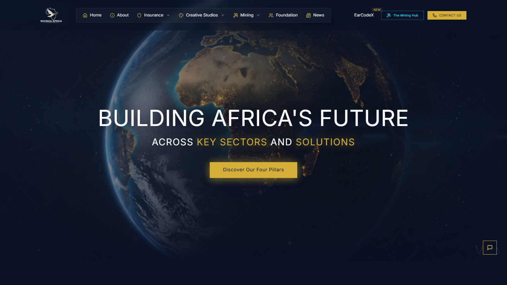

# Socinga Africa Enterprise Website — Sanitised Portfolio Case Study

**Live public artefact:** [https://www.socinga.africa/](https://www.socinga.africa/)  
**Portfolio role:** Enterprise digital platform, public-facing systems architecture and cross-border stakeholder communication  
**Repository posture:** Public case study only. Production implementation and internal operations are private.

_Generated portfolio visual; not a confidential product screenshot._

_Public live artefact screenshot captured on 4 June 2026._

## Overview

Socinga Africa is a public enterprise website spanning insurance, creative studios, mining, foundation, news and EarCodeX positioning.

## My Role

I contributed to the digital-platform structure, public-facing content architecture, regulated-sector positioning and systems thinking behind a multi-division enterprise web presence.

## What This Demonstrates

- Enterprise information architecture across multiple business divisions.
- Public-facing content systems for credibility, stakeholder review and market communication.
- Regulated-sector positioning across insurance, investment, mining, media and social-impact work.
- Governance-conscious separation between public communications and private operations.

## Technical Proof

- **Delivery signals:** Enterprise information architecture, multi-division content structure, regulated-sector positioning and public stakeholder communication.
- **Public evidence:** Live site divisions, public news surface, stakeholder-facing sections and high-level architecture explanation without operational exposure.
- **Confidentiality boundary:** No credentials, private operations, client data, infrastructure details, internal workflows, deployment configuration, non-public documents or implementation source are published here.

## Public Review Context

The live artefact presents the approved public experience. This repository adds role, architecture and systems-positioning context. For broader review, visit the [N.White Systems portfolio](https://nwhite.systems/portfolio-review) or the [public GitHub portfolio index](https://github.com/whitemorengwira/nwhitesystems).

## Confidentiality

The implementation repository is private. Deeper walkthroughs can be provided only where permission and confidentiality allow.

## Usage Rights

This repository is public for portfolio review only and is not open-source licensed. See [COPYRIGHT.md](COPYRIGHT.md) for usage boundaries.

## Request a Walkthrough

Contact [hello@nwhite.systems](mailto:hello@nwhite.systems?subject=Private%20portfolio%20walkthrough%20-%20Socinga%20Africa%20Enterprise).
